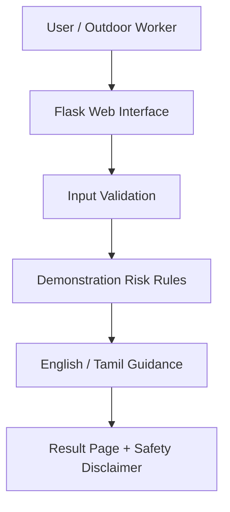

# Technical Design Document

## 1. Purpose

Demonstrate a basic heat-awareness workflow for a student prototype. The current implementation accepts user-entered temperature and relative humidity and returns an illustrative risk category plus precautionary text.

## 2. Architecture

## 3. Components

- `app.py`: Flask route, form handling, input validation, and page rendering.
- `heat_risk.py`: deterministic demonstration scoring and bilingual guidance.
- `templates/index.html`: input form and result presentation.
- `static/style.css`: responsive styling.
- `tests/test_heat_risk.py`: unit tests for categories, validation, and language selection.
- `data/sample_conditions.csv`: synthetic example inputs for manual testing.

## 4. Data flow

1. User enters temperature (°C) and relative humidity (%).
2. Flask validates numeric ranges.
3. The rule function calculates a demonstration score.
4. A category is selected using hard-coded demo thresholds.
5. The UI presents guidance and a clear limitation statement.

No user data is stored, and no external API is called by this version.

## 5. Security and privacy

- No personal data is requested or persisted.
- Configure a strong `SECRET_KEY` before deployment.
- Keep secrets in environment variables and never commit `.env`.
- For public deployment, use a production WSGI server, HTTPS, secure configuration, logging, and dependency updates. Do not use Flask's development server in production.

## 6. Safety and model limitations

- The score is an illustrative rule, not a validated predictive model.
- The thresholds are not official occupational limits.
- Temperature and relative humidity alone do not provide enough inputs to calculate WBGT.
- Real deployment requires expert review, validated reference standards, suitable sensor/weather data, local occupational-health guidance, and field testing.
- Recommendations must not imply that any risk category guarantees safety.
- Cooling-facility mapping and notifications are planned features, not implemented in this code.

## 7. Testing strategy

Run `pytest -q`. Tests cover expected categories, Tamil guidance, invalid input, and boundary input. Additional integration tests should be added before deployment.

## 8. Future architecture

A future version may add a weather-provider adapter, a validated risk assessment service, opt-in notifications, and a verified cooling-resource database. Each integration should be independently tested and documented.
